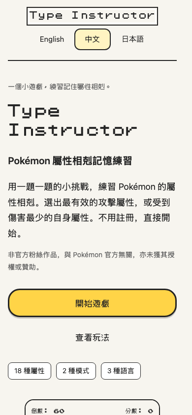
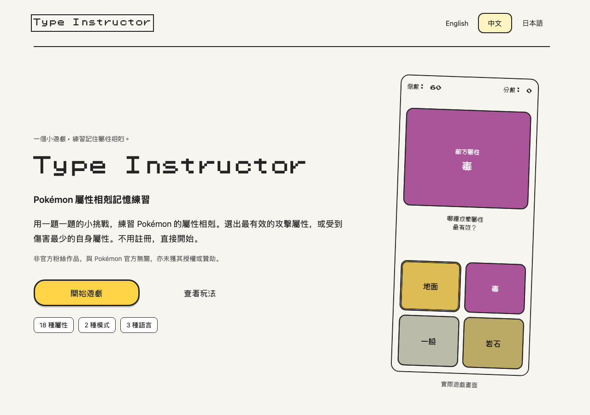

# 三語遊戲介紹頁

介紹頁：`#/en/about`、`#/zh/about`、`#/ja/about`。從 Home 的「遊戲介紹」進入，
切換語言後仍留在介紹頁；「開始遊戲」會開啟同語言的模式選單。
Home 不顯示 GitHub 連結；原始碼連結保留在介紹頁頁尾。

## 內容與排版

- 介紹單屬性攻防、三個操作步驟、60 秒一般模式與 20 分競速模式。
- 說明答對加一分、答錯扣一分，以及鍵盤操作、回饋和離線使用。
- 手機使用單欄，桌面使用雙欄；介紹頁可在 App 安全區域內捲動。
- 遊戲各頁維持原本不需捲動的布局。

實際瀏覽器預覽：

| 手機 390 × 844            | 桌面 1280 × 900            |
| ------------------------- | -------------------------- |
|  |  |

## 實際遊戲截圖

頁面使用 `src/images/landing/` 內的九張 PNG，英文、繁體中文、日文各有選單、攻擊題及防禦題。
圖片直接擷取遊戲，不合成或修改遊戲畫面，並使用本機資源與本地化替代文字。
來源版本及擷取設定見同目錄的 `capture.json`。

重新擷取：

```sh
pnpm screenshots:landing
```

指令會建置目前版本，啟動獨立的正式預覽伺服器，以 Chromium 的 390 × 844 viewport 擷取。
計時器暫停、題目固定為毒屬性，方便比較各語言。需要先安裝 Playwright Chromium。
本指令更新來源紀錄，因此只應在需要更新遊戲截圖時執行。
若使用本機 Chrome，可執行 `PLAYWRIGHT_CHANNEL=chrome pnpm screenshots:landing`。
來源紀錄會標示擷取時是否包含尚未提交的修改；擷取前等待字型完成載入，並透過一般點擊將焦點移離操作按鈕。

## 驗證

新增 `tests/e2e/landing.spec.js`，涵蓋：

- 三語在 320 × 568、390 × 844、844 × 390、1280 × 900 的排版及無水平溢出。
- About 的 computed overflow 與實際輸入捲動：桌面用滾輪，手機 WebKit 用 PageDown（測試工具不支援該設定的滾輪）。另以 Chromium 手機模擬確認觸控滑動。
- 語言切換、查看玩法、進入遊戲、返回固定布局、Home 不顯示 GitHub 連結、介紹頁原始碼連結。
- 四張可見圖片的來源語言、實際尺寸與離線載入。
- 三語 axe WCAG 2 A／AA 與 2.1 AA 自動掃描。

完整矩陣涵蓋桌面 Chromium、Firefox、WebKit 與 iPhone 13 尺寸 WebKit 模擬。
手機模擬不代表 iOS 實機驗證；自動掃描不等同完整無障礙稽核。

本次驗證：lint、型別檢查、15 個單元測試通過。正式版完整矩陣先有 141 個通過；
三個手機 WebKit 案例因測試工具不支援滾輪而中止，改用 PageDown 後，六個手機介紹頁案例全部通過。
涵蓋完整 144 個案例，修正測試輸入方式期間沒有變更應用程式。開發版另有八個針對性案例通過。

## 名稱與非官方聲明

Home 和介紹頁以「Type Instructor」作為主標，副標依語言說明 Pokémon 屬性相剋練習。
兩頁都顯示非官方、無官方關聯、未獲授權或贊助的聲明。介紹頁的聲明放在首屏介紹文字下方，
Home 放在頁尾，手機版仍維持不需捲動。瀏覽器標題及安裝後的 App 名稱也使用 Type Instructor。
這項呈現調整不代表已取得授權或已排除法律風險。

名稱調整已通過 lint、型別檢查與 12 份 OpenSpec 嚴格驗證；
Chromium 的介紹頁／布局／導頁共 12 個案例，以及手機 WebKit 的相同頁面與遊戲流程共 28 個案例均通過。
另外檢查三語在 320 × 568、390 × 600、844 × 390、1280 × 900 的主標、副標、聲明與瀏覽器標題，
確認 Home 聲明完整顯示。預覽圖已更新。

## PWA 安裝說明

介紹頁的 `#install-app` 區塊提供三語安裝步驟：iPhone／iPad 的 Safari、Android 的 Chrome，
以及電腦的 Chrome／Edge。使用瀏覽器原生安裝選單，並提供官方說明連結。
從 Threads 等 App 內開啟的讀者會看到改用瀏覽器的提示。
離線說明會區分「安裝完成」和「首次下載與快取完成」；安裝選項不可用時仍能直接在瀏覽器遊玩。

操作步驟參照 [Apple](https://support.apple.com/zh-tw/guide/iphone/iphea86e5236/ios)、
[Google Chrome](https://support.google.com/chrome/answer/9658361) 與
[Microsoft Edge](https://support.microsoft.com/en-US/edge/install-manage-or-uninstall-apps-in-microsoft-edge) 官方說明。

安裝區塊預覽：[手機](install-mobile.png)／[桌面](install-desktop.png)。
已檢查三語在 320px、390px、1280px 的說明、九個步驟及官方連結。
Chromium／手機 WebKit 的 12 個 About 案例通過，包含三語 axe 掃描與離線資源檢查。
瀏覽器模擬未操作系統原生安裝對話框，實機安裝仍需人工確認。
